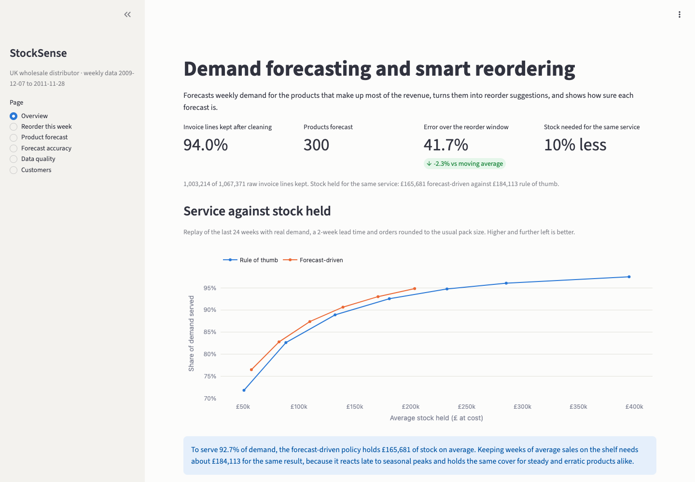
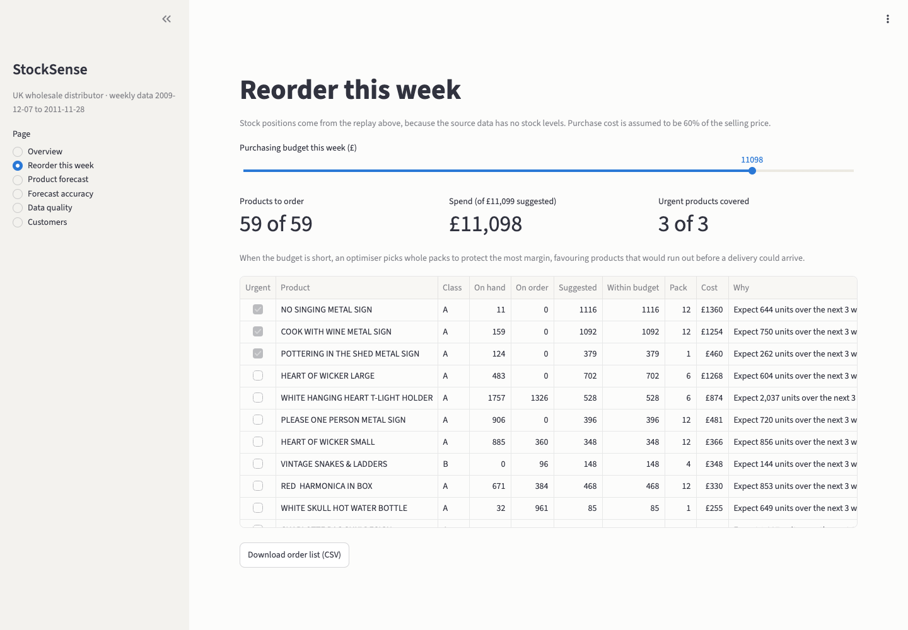
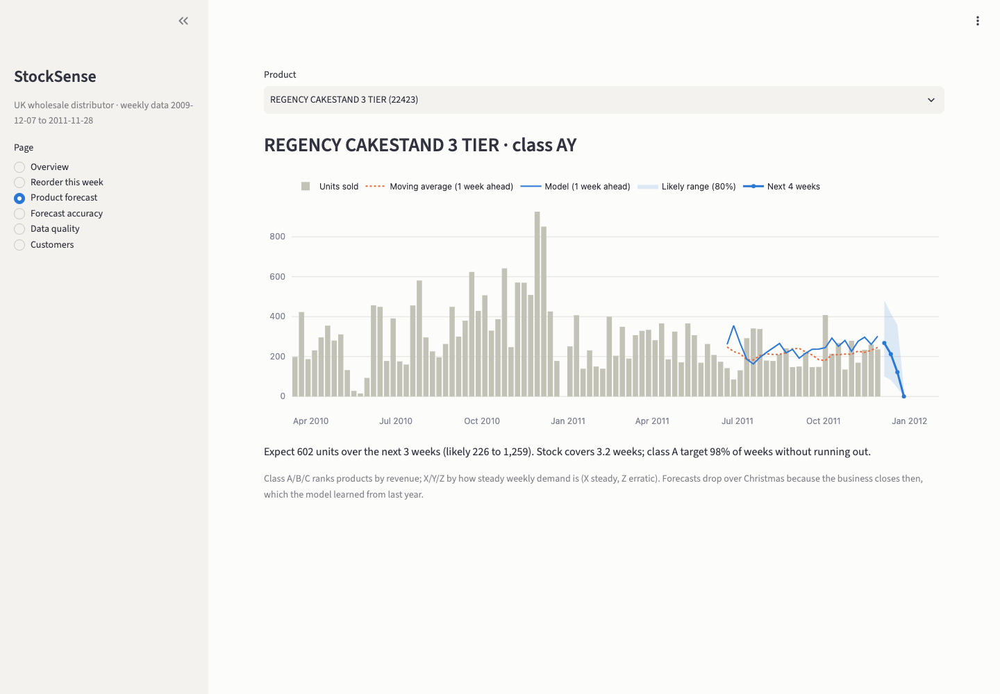
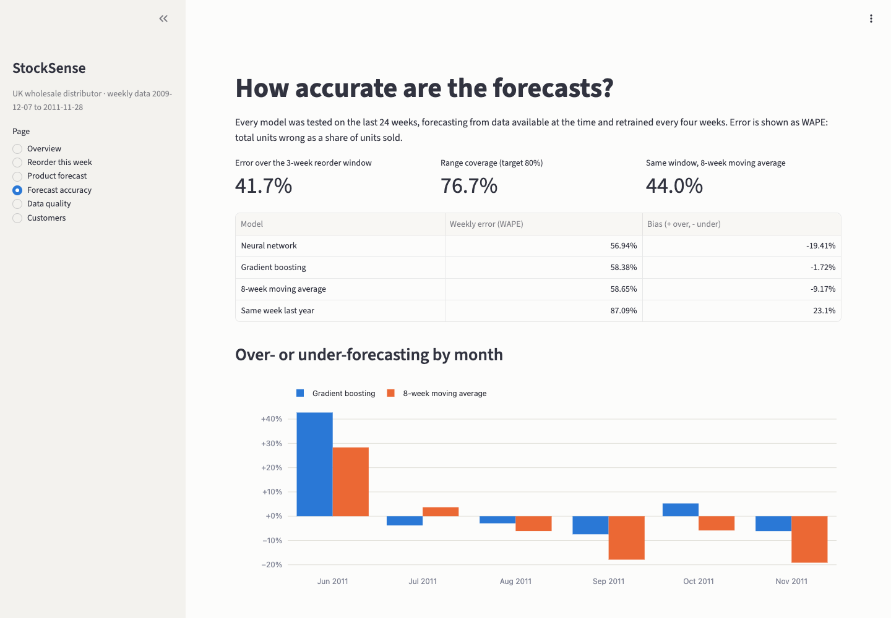

# StockSense

**Demand forecasting and smart reordering for a wholesale distributor, built on real ERP-style sales data.**

StockSense takes a messy invoice export, cleans it with a full record of every fix, forecasts weekly demand for the products that drive most of the revenue, and turns those forecasts into a weekly reorder list that a non-technical buyer can read and trust. Every forecast comes with a likely range, and every suggestion comes with its reason in plain words.



## The problem

Many distributors run on an ERP system that was never designed for analytics, and on buyers who have learned over years roughly how much of each product to keep. A common habit is to keep "about four weeks of recent sales" on the shelf. That works until demand changes: it reacts late to seasonal peaks, and it holds the same cover for a steady seller as for an erratic one.

StockSense tests whether forecasting can do better, measured the way a business measures it: how often do we run out, and how much stock do we hold to avoid it?

## Data

[Online Retail II](https://doi.org/10.24432/C5CG6D) (UCI Machine Learning Repository, CC BY 4.0): **1,067,371 invoice lines** from a UK-based wholesaler, December 2009 to December 2011, sold mostly to other businesses. It has the problems of a real ERP export:

| What the raw data contained | Lines | Action |
|---|---:|---|
| Exact duplicate lines | 34,335 | Removed |
| Cancelled invoices | 19,104 | Moved to a returns table |
| Postage, fees, manual adjustments, samples and vouchers mixed in with products | 4,790 | Removed |
| Negative quantities on sales invoices (stock corrections) | 3,362 | Moved to an adjustments table |
| Zero or negative prices | 2,566 | Removed |
| Missing customer ID | 226,637 | Kept for demand, excluded from customer analysis |
| One-off bulk orders (1,000+ units, 10x the usual line) | 173 | Kept in sales, excluded from forecasting |
| Products recorded under more than one description | 599 products | Standardised to the most common description |

**94.0% of lines are kept**, and every removed line is counted, so the totals always reconcile (this is checked in the tests).

## Results

All results come from the last **24 weeks**, which the models never saw during training. At each week the models forecast from data available at the time, and they are retrained every four weeks, exactly as they would run in use.

**Stock and service.** Both ordering policies were replayed week by week against real demand, with a two-week supplier lead time and orders rounded to each product's usual pack size:

| | Share of demand served | Average stock held (at cost) |
|---|---:|---:|
| Forecast-driven policy | **92.7%** | **£165,681** |
| Rule of thumb, at the same service level | 92.7% | £184,113 |

**The forecast-driven policy needs about 10% less stock for the same service**, and the gap widens at higher service levels. The chart above shows both policies across a range of settings, so the comparison is made at equal stock rather than at a single chosen point.

**Forecast accuracy** (WAPE: total units wrong as a share of units sold, 300 products):

| Model | Weekly error | Error over the 3-week reorder window | Bias |
|---|---:|---:|---:|
| Gradient boosting (used) | 58.4% | **41.7%** | **-1.7%** |
| Neural network | 56.9% | 44.4% | -19.4% |
| 8-week moving average | 58.7% | 44.0% | -9.2% |
| Same week last year | 87.1% | 64.1% | +23.1% |

Week-by-week demand for one product at a wholesaler is lumpy, often a handful of large orders, so no model is close to perfect at that level. The gains show where decisions are made: over the reorder window, and in the September to November peak, where the moving average under-forecast by about 18% and the model stayed close to zero bias. The neural network has the lowest weekly error but under-forecasts consistently, which would cause stockouts, so gradient boosting is used. Its 10th to 90th percentile range contained the actual demand 76.7% of the time (target 80%).

## What it does

| Step | What happens | Code |
|---|---|---|
| 1. Ingest | Downloads the dataset and caches it as parquet | `stocksense/ingest.py` |
| 2. Clean | Eight data-quality rules, each with a count, an action and a reason | `stocksense/clean.py` |
| 3. Model the data | DuckDB tables for sales, returns, adjustments, products, customers and a zero-filled weekly demand table | `stocksense/warehouse.py` |
| 4. Forecast | One model across all products, 1 to 4 weeks ahead, with a likely range; compared with three alternatives | `stocksense/forecast.py` |
| 5. Reorder | ABC/XYZ classes, service targets per class, safety stock from the forecast range, pack-size rounding, and an integer optimiser for when the budget is short | `stocksense/inventory.py` |
| 6. Customers | Rule-based segments and a list of regular customers who are buying less, with reasons | `stocksense/customers.py` |
| 7. Dashboard | Overview, this week's reorder list with a budget slider, product forecasts, accuracy, data quality and customers | `app/streamlit_app.py` |





## Design choices

- **Judge forecasts by the decisions they drive.** Weekly accuracy alone undersold the model and oversold the neural network. Replaying the ordering policies against real demand gives a measure a buyer recognises: service and stock.
- **Compare at equal stock.** A policy that holds more stock will always serve more demand. Running both policies at several settings and comparing them at the same service level makes the result fair.
- **No look-ahead.** Every feature is built only from weeks up to the forecast date, and a test rewrites all future data to prove the features do not change.
- **Ranges, not just numbers.** Safety stock comes from the forecast's own uncertainty, so erratic products get more cover and steady products less. The range is also shown to users, so they know when to trust a forecast and when to check it.
- **Plain-English reasons.** Each suggestion says what demand is expected, how long current stock will last and what service target applies, so buyers can challenge it rather than simply accept or ignore it.
- **Assumptions in one place.** The data has no stock levels, purchase costs or lead times, so these are stated in `stocksense/config.py` (two-week lead time, cost at 60% of the selling price, service targets of 98%, 95% and 90% for classes A, B and C) and can be changed in one place.



## Running it

```bash
python -m venv .venv && source .venv/bin/activate
pip install -r requirements.txt && pip install -e .
python -m stocksense.pipeline          # downloads the data the first time; a few minutes in total
streamlit run app/streamlit_app.py
pytest                                 # 10 tests
```

`python -m stocksense.pipeline --quick` skips the neural network.

## Next steps

- Replace the assumed lead times and costs with supplier data, and add actual stock levels from the ERP so the reorder list starts from real positions.
- Add promotions, price changes and customer order books as forecast inputs; for a distributor, known upcoming orders from large customers are often the strongest signal.
- Forecast at the level buyers order (supplier and product family) and reconcile it with product-level forecasts.
- Track forecast accuracy and service in production, and retrain automatically when accuracy drifts.

---
Built by Mahum Maqbool · [github.com/mahum24](https://github.com/mahum24)
